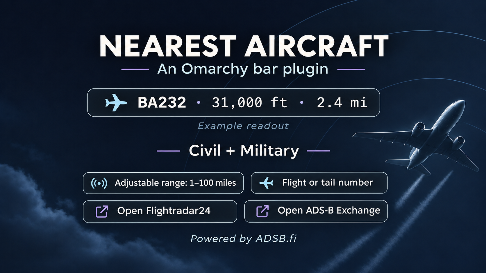

# Nearest Aircraft



A compact Omarchy bar widget showing the nearest **reported airborne aircraft** to a location you set locally.

**Flight or tail number · Altitude · Distance**

- Civil, Military and unclassified aircraft are eligible.
- Search range from **1 to 100 statute miles**, default 70 miles.
- Airline flight numbers where reliably derivable, such as `BAW232 → BA232`; registrations preferred for GA and provider-flagged military aircraft.
- Click for aircraft details and **Flightradar24** / **ADS-B Exchange**, opened in your default browser.
- Theme-aware compact readout, local home settings, pause/resume and demonstration mode.
- Live aircraft data from [ADSB.fi](https://adsb.fi/), refreshed every ten seconds while configured and enabled.

## Requirements

Omarchy Quattro with the Quickshell service/bar-widget plugin API, **Python 3** and **curl** on PATH. No API key or paid subscription is needed. The Python helper uses only the standard library. Node.js and Qt Test are needed only for the developer checks below.

## Install

Review the code and install using Omarchy's plugin manager:

```sh
omarchy plugin add https://github.com/shaggyrs6-netizen/omarchy-nearest-aircraft --enable
```

If you installed without enabling it:

```sh
omarchy plugin enable shaggyrs6.nearest-aircraft --section centerBegin --index 0
```

This places the widget beside the clock. An existing manually installed plugin with the same ID should be reviewed before replacing it; do not overwrite its directory blindly.

## Set your location and range

1. Click **Set home** in the bar.
2. Enter decimal latitude and longitude from your own map pin.
3. Click **Save home & start** to begin polling.

The widget performs **no address lookup**. Exact coordinates are stored privately on your machine. Nothing polls before a valid location is saved.

Change **Search range** in the popup and click **Apply**, or change it in the widget settings. Range is a whole number from 1 to 100 miles and persists across restarts. The popup also has **Pause polling**, **Resume polling** and **Change home** controls.

To open the popup from a terminal:

```sh
omarchy-shell shaggyrs6.nearest-aircraft open
```

To set the range from a terminal:

```sh
omarchy bar set shaggyrs6.nearest-aircraft rangeMiles 10 --json
```

**Demonstration mode** in widget settings uses synthetic aircraft, with a clearly labelled popup. It makes no feed requests and does not read your saved home.

## Pause, disable or remove

Closing the popup leaves the bar and polling running. Use **Pause polling** to retain the widget but stop requests.

Disable the plugin:

```sh
omarchy plugin disable shaggyrs6.nearest-aircraft
```

Remove it using the plugin manager:

```sh
omarchy plugin remove shaggyrs6.nearest-aircraft
```

Disabling stops the owned worker. Removing the plugin does not intentionally delete your private home settings under `~/.local/state/nearest-aircraft`; review that directory separately if you also want to remove saved location data. This plugin does not install a systemd service, independent autostart, privileged component or configuration hook.

## Privacy and network access

Your exact location is saved in `home.json` under `$XDG_STATE_HOME/nearest-aircraft` (normally `~/.local/state/nearest-aircraft`), with directory permissions 0700 and file permissions 0600. Range and demo settings are stored in Omarchy's normal shell settings.

ADSB.fi receives a search centre **rounded to 0.1 degrees** and an expanded radius covering your selected circle. This still reveals an approximate area to the provider. Exact distance ranking happens locally. No raw aircraft responses, location history or analytics are saved. Opening a tracking link contacts the chosen external site through your browser.

One Python worker is shared across bar instances. A lock and persisted request budget prevent duplicate polling during reloads. Requests use fixed HTTPS sources, connection/overall timeouts, response-size limits, backoff and a three-failure circuit breaker. Provider 4xx restrictions stop automatic requests; manual retry preserves the provider cooldown.

## Aircraft identifiers and coverage

Distance is horizontal. Ground contacts and surface vehicles are excluded. Positions must be no more than 20 seconds old, including provider delay; stale positions stop appearing as current.

Known numeric airline callsigns use a small curated ICAO/IATA mapping. Regional codeshares and alphanumeric callsigns remain as broadcast; marketed flight numbers cannot always be reconstructed. Missing tail numbers fall back to callsign, then contact address. Military metadata can be missing or incomplete.

Barometric altitude is preferred; a GPS/geometric fallback is labelled in the popup. Unavailable altitude is `? ft`. This is the nearest aircraft **reported by the available feed**, not a guarantee of every aircraft physically nearby. It is an interest widget, not a navigation or safety instrument.

Flightradar24 opens a public aircraft page where a registration is known, otherwise a recognised flight page or homepage. ADS-B Exchange selects the ICAO contact where supported. Neither link guarantees that the other provider has a current track.

## Updates and troubleshooting

Use Omarchy's normal plugin update controls. After a reviewed update, if the shell retains old QML, `omarchy restart shell` loads the new code. **Do not use `omarchy refresh shell`** to update this plugin: it resets shell configuration.

If the bar shows a feed restriction or repeated failure, inspect connectivity and use the popup's retry control. Do not repeatedly reload to bypass a provider cooldown. Status without home coordinates:

```sh
omarchy-shell shaggyrs6.nearest-aircraft.service status
```

## Development checks

```sh
./bin/test
./bin/test-gui
```

The first command runs Python selection/privacy/range tests, UI safety checks and Omarchy manifest validation. The second launches an isolated synthetic Qt interaction test for the bar click, browser-button availability and range callback. It does not read your home or poll aircraft data.

## Licence and attribution

Source: [MIT](LICENSE). See [NOTICES.md](NOTICES.md). The preview is AI-generated promotional artwork with a labelled fictional example, not an exact screenshot.

Aircraft data is provided by [ADSB.fi](https://adsb.fi/). Its [open-data rules](https://github.com/adsbfi/opendata) allow personal, non-commercial use and require attribution; those service rules are separate from the source-code licence. No live feed dataset is redistributed here. Flightradar24, ADS-B Exchange, Omarchy and airline names belong to their respective owners; no endorsement is implied.
